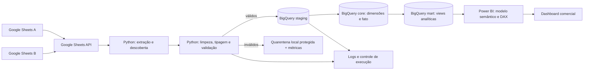

# Retail Analytics Pipeline | Google Sheets → Python → BigQuery → Power BI

> **Projeto guiado, end-to-end, para portfólio de Engenharia e Análise de Dados.** Status: especificação inicial; implementação pendente. O esquema das planilhas deve ser descoberto e validado antes de executar as consultas ilustrativas.

## Sumário

1. [Visão geral](#1-visão-geral)
2. [Arquitetura e organização](#2-arquitetura-e-organização)
3. [Pré-requisitos](#3-pré-requisitos)
4. [Fluxo de dados](#4-fluxo-de-dados)
5. [Requisitos do projeto](#5-requisitos-do-projeto)
6. [Qualidade, custos e segurança](#6-qualidade-custos-e-segurança)
7. [Entregáveis e definição de pronto](#7-entregáveis-e-definição-de-pronto)
8. [Referências e premissas](#8-referências-e-premissas)

## 1. Visão geral

### Contexto do negócio

O projeto parte do cenário **didático de varejo omnichannel** descrito no material *Memória de contexto técnica — Curso Básico de Power BI 2026* (Hashtag Treinamentos): vendas anuais, clientes, lojas e produtos. A proposta é analisar faturamento, unidades vendidas, devoluções, clientes distintos, participação do canal online, evolução mensal e desempenho por marca e região.

**Atenção ao escopo:** as duas URLs abaixo foram fornecidas como fontes, mas seu conteúdo, nomes de abas, cabeçalhos, volumes e permissões **não puderam ser verificados nesta especificação**. Os campos e as tabelas usados nos exemplos são um **contrato-alvo hipotético**, inspirado no documento do curso, e precisam ser mapeados para o esquema real na etapa de descoberta. Não se deve assumir que os links contêm necessariamente todas as tabelas do exercício.

- [Planilha de origem A](https://docs.google.com/spreadsheets/d/1kMau11VHrNjGijHWZ1ii0c_U2zcuCTUE_T04MReKjJE/edit?usp=sharing)
- [Planilha de origem B](https://docs.google.com/spreadsheets/d/1ivLs5NDUxHZNU8cK8RRSIzfWVoGPKd2R6B9eah2elx8/edit?usp=sharing)

### Objetivo técnico

Implementar uma ingestão reproduzível via **Google Sheets API**, limpar e validar registros com Python, publicar dados tratados no **BigQuery**, modelar um **esquema estrela** e consumir o Data Mart no **Power BI**. Demonstrar testes, idempotência, logs, controle de erros, versionamento e documentação.

### Perguntas de negócio

- Qual o faturamento bruto e sua evolução mensal?
- Quais marcas, categorias, lojas e regiões lideram vendas?
- Qual o volume de devoluções e a taxa de devolução?
- Qual a participação de unidades vendidas no canal online?
- Quantos clientes distintos compraram em cada período?
- Como as métricas mudam ao filtrar ano, canal, gênero ou faixa etária?

**Definições iniciais (a confirmar com os dados):** faturamento bruto = `SUM(quantidade_vendida × preco_unitario_venda)`; devolução (%) = `SUM(quantidade_devolvida) / SUM(quantidade_vendida)`; participação online (%) = `unidades vendidas online / unidades vendidas totais`; ticket médio = faturamento / número de pedidos **somente se houver identificador confiável de pedido**. Caso contrário, rotular a média por linha de venda como *valor médio por registro*, e não ticket médio. Receita líquida, margem e taxa por pedido dependem de regras e campos adicionais.

### Habilidades trabalhadas

Python, Pandas, Google Sheets API, autenticação por Service Account, contratos de dados, validação, SQL analítico, BigQuery, `MERGE`, modelagem dimensional, DAX (`SUM`, `DIVIDE`, `CALCULATE`, `DISTINCTCOUNT`), Power Query, visualização, Git e pytest. A transformação principal será em Python/BigQuery; o Power Query servirá para inspeção e ajustes leves de apresentação, sem duplicar regras de negócio.

## 2. Arquitetura e organização

### Estrutura proposta

```text
retail-analytics-pipeline/
├── README.md
├── requirements.txt
├── .env.example
├── .gitignore
├── config/
│   ├── sources.example.yaml      # IDs, abas e mapeamentos, após descoberta
│   └── data_contract.md          # esquema validado, granularidade e regras
├── scripts/
│   ├── discover.py               # enumeração de abas e cabeçalhos
│   ├── extract.py                # Google Sheets API
│   ├── transform.py              # limpeza e tipagem
│   ├── validate.py               # verificações e quarentena
│   ├── load.py                   # carga no BigQuery
│   └── pipeline.py               # orquestração local
├── queries/
│   ├── 01_datasets.sql
│   ├── 02_staging.sql
│   ├── 03_dimensions.sql
│   ├── 04_fact.sql
│   ├── 05_marts.sql
│   └── 06_quality_checks.sql
├── tests/
│   ├── test_transform.py
│   ├── test_validate.py
│   └── test_idempotency.py
├── data/
│   └── rejected/.gitkeep        # não publicar dados pessoais
├── logs/.gitkeep
├── pbix/
│   ├── retail_analytics.pbix     # produzido no Power BI Desktop
│   └── dax_measures.md
└── docs/
    ├── data_dictionary.md
    ├── architecture.md
    ├── dashboard_screenshots/
    └── decisions.md
```

### Camadas de dados

| Camada | Local | Responsabilidade |
|---|---|---|
| Fonte | Google Sheets | Dados operacionais; nunca editar via pipeline |
| Extração | Python local | Ler via API, preservar referência de aba/linha |
| Preparação | Python local | Normalização, tipos, regras, rejeitados |
| Staging | BigQuery `retail_staging` | Dados limpos com metadados de execução |
| Core | BigQuery `retail_core` | Dimensões e fato no grão documentado |
| Mart | BigQuery `retail_mart` | Visões analíticas e indicadores reutilizáveis |
| Consumo | Power BI Desktop | Modelo semântico, DAX, filtros e visuais |

**Decisão de projeto:** usar cargas completas e substituição atômica de tabelas de staging no MVP, seguida de reconstrução determinística de core/marts. Isso é mais simples e seguro para bases pequenas que um incremental prematuro. Evolução opcional: `MERGE` por chave natural estável, controle de exclusões e snapshots.

## 3. Pré-requisitos

- Python **3.11+**, Git, VS Code, Power BI Desktop (Windows), projeto GCP com faturamento/cotas verificados e BigQuery API habilitada.
- Google Sheets API habilitada no mesmo projeto (ou projeto autorizado), Service Account com acesso **Leitor** às duas planilhas, e permissões mínimas no BigQuery para criar jobs e gravar nos datasets previstos.
- Uma identidade para Python (Service Account) e uma identidade de usuário/organizacional para o conector BigQuery no Power BI; permissões de consulta no Data Mart.
- Confirmar região do BigQuery (ex.: `southamerica-east1`), custos de armazenamento/consultas e eventuais restrições do sandbox gratuito. **Não presumir que cargas e DML funcionam sem billing**.

### `requirements.txt`

```txt
pandas>=2.2,<3
numpy>=1.26,<3
gspread>=6,<7
google-auth>=2,<3
google-cloud-bigquery>=3,<4
google-cloud-bigquery-storage>=2,<3
pyarrow>=17,<24
python-dotenv>=1,<2
PyYAML>=6,<7
pytest>=8,<10
```

> Faixas são sugestões de compatibilidade, não versões congeladas. Após instalar e validar, gerar um arquivo de lock para reprodutibilidade. `google-cloud-bigquery-storage` é opcional para leitura acelerada, mas está incluído no ambiente didático.

### Inicialização

```powershell
python -m venv .venv
.\.venv\Scripts\Activate.ps1
python -m pip install -r requirements.txt
Copy-Item .env.example .env
```

`.env.example` (sem segredos):

```dotenv
GCP_PROJECT_ID=seu-projeto
BQ_LOCATION=southamerica-east1
GOOGLE_APPLICATION_CREDENTIALS=C:/caminho/privado/service-account.json
SHEET_A_ID=1kMau11VHrNjGijHWZ1ii0c_U2zcuCTUE_T04MReKjJE
SHEET_B_ID=1ivLs5NDUxHZNU8cK8RRSIzfWVoGPKd2R6B9eah2elx8
```

**Autenticação:** em desenvolvimento local, preferir Application Default Credentials (`gcloud auth application-default login`) quando permitido; se usar JSON de Service Account, guardá-lo **fora do repositório**. Compartilhar cada planilha com o `client_email` da Service Account: ela é uma identidade distinta da conta pessoal que criou a planilha. Nunca commitar `.env`, chaves, dumps de clientes ou dados identificáveis.

`.gitignore` mínimo:

```gitignore
.venv/
.env
*.json.key
*service-account*.json
__pycache__/
.pytest_cache/
logs/*
!logs/.gitkeep
data/rejected/*
!data/rejected/.gitkeep
```

## 4. Fluxo de dados



## 5. Requisitos do projeto

> **Modo Trybe:** desenvolver cada requisito em branch própria, abrir PR, incluir evidências e somente avançar após os critérios de aceite. Os exemplos são **esqueletos orientativos**, não substituem o mapeamento do esquema real. Para executar SQL, substituir `SEU_PROJETO` pelo ID do projeto e adaptar nomes de campos documentados.

### Requisito 1 — Preparar repositório e ambiente

**Objetivo:** instalar dependências, configurar credenciais e verificar acesso às APIs.

**Detalhamento e orientação:** criar a estrutura, `.env.example`, `.gitignore`, ambiente virtual e projeto GCP. Configurar papéis mínimos: `roles/bigquery.jobUser` no projeto de execução e `roles/bigquery.dataEditor` apenas nos datasets de escrita; `roles/bigquery.dataViewer` para consumo. Habilitar APIs e compartilhar as duas planilhas com a Service Account.

**Exemplo:**

```python
from dotenv import load_dotenv
from google.cloud import bigquery
import os

load_dotenv()
client = bigquery.Client(project=os.environ['GCP_PROJECT_ID'])
print('Projeto autenticado:', client.project)
```

**O que será testado:** ambiente sobe sem chave no Git; autenticação funciona; acesso de leitura ao Sheets e criação de job no BigQuery são confirmados separadamente.

### Requisito 2 — Descobrir as planilhas e fechar o contrato de dados

**Objetivo:** identificar **quais abas e colunas existem de fato**, qual a granularidade e como as duas fontes se relacionam.

**Detalhamento e orientação:** enumerar abas, dimensões, primeira linha útil, linhas decorativas, colunas vazias, chaves e tipos aparentes. Registrar em `docs/data_dictionary.md` uma tabela com `planilha`, `aba`, `coluna_original`, `coluna_destino`, `tipo`, `obrigatório`, `regra`, `exemplo mascarado`. Decidir quais abas são vendas, clientes, lojas e produtos, **somente se existirem**. Verificar se vendas estão distribuídas por anos/abas e se têm estrutura compatível para concatenação. Identificar identificador de pedido ou transação, se houver.

**Exemplo:**

```python
import os
import gspread
from dotenv import load_dotenv

load_dotenv()
gc = gspread.service_account() if not os.getenv('GOOGLE_APPLICATION_CREDENTIALS') else gspread.authorize(
    __import__('google.auth', fromlist=['default']).default(
        scopes=['https://www.googleapis.com/auth/spreadsheets.readonly']
    )[0]
)
for key in ('SHEET_A_ID', 'SHEET_B_ID'):
    book = gc.open_by_key(os.environ[key])
    for tab in book.worksheets():
        print(key, tab.title, tab.row_count, tab.col_count)
        print('Primeiras linhas:', tab.get('A1:K5'))
```

**O que será testado:** inventário completo das duas planilhas; contrato aprovado; nenhum cabeçalho ou relacionamento presumido; ausência de abas esperadas documentada como impedimento/ajuste de escopo.

### Requisito 3 — Extrair via API, sem download manual

**Objetivo:** ler as fontes com Python e manter rastreabilidade.

**Detalhamento e orientação:** usar `gspread`, leitura por aba, respeitar cotas, preservar `source_spreadsheet_id`, `source_tab`, `source_row` e `extracted_at`. Não usar exportação manual CSV/Excel. Se houver linhas de título decorativas, detectar/configurar a linha do cabeçalho em vez de assumir a primeira linha.

**Exemplo:**

```python
from datetime import datetime, timezone
import pandas as pd

def extract_tab(book, tab_name, header_row=1):
    rows = book.worksheet(tab_name).get_all_values()
    headers = rows[header_row - 1]
    records = rows[header_row:]
    df = pd.DataFrame(records, columns=headers)
    df['source_row'] = range(header_row + 1, header_row + 1 + len(df))
    df['source_tab'] = tab_name
    df['source_spreadsheet_id'] = book.id
    df['extracted_at'] = datetime.now(timezone.utc)
    return df
```

**O que será testado:** total de linhas lidas por aba; execução repetível; erro claro para aba inexistente; nenhuma alteração na fonte.

### Requisito 4 — Normalizar campos e corrigir tipos

**Objetivo:** transformar dados heterogêneos em registros consistentes.

**Detalhamento e orientação:** criar mapeamentos explícitos de colunas por aba, normalizar espaços e valores ausentes, datas com formato declarado, inteiros e valores monetários com precisão decimal. Aplicar regras de negócio do curso **somente quando compatíveis**: dividir localidade composta, recombinar nome de gerente, padronizar gênero, classificar faixa etária e corrigir preço/custo que tenham escala ×100 comprovada. **Nunca dividir valores por 100 indiscriminadamente.** Idade deve usar uma data de referência declarada, evitando mudança silenciosa no histórico.

**Exemplo:**

```python
import pandas as pd
from decimal import Decimal, InvalidOperation

def clean_text(value):
    if pd.isna(value):
        return None
    value = ' '.join(str(value).strip().split())
    return value or None

def parse_money_br(value):
    value = clean_text(value)
    if value is None:
        return None
    try:
        return Decimal(value.replace('R$', '').replace('.', '').replace(',', '.').strip())
    except InvalidOperation as exc:
        raise ValueError(f'Valor monetário inválido: {value!r}') from exc

# Exemplo para números em formato pt-BR: "1.234,56" -> Decimal('1234.56')
# Para valores no padrão en-US, implementar parser distinto, definido por coluna.
```

**O que será testado:** nulos e espaços, separador decimal, datas inválidas, escala monetária, acentos, duplicatas e idempotência das transformações.

### Requisito 5 — Validar dados e produzir quarentena

**Objetivo:** impedir que registros inválidos contaminem os indicadores.

**Detalhamento e orientação:** verificar chaves não nulas, unicidade em cadastros, datas válidas, quantidades não negativas, valores monetários válidos e integridade referencial. Definir política para `quantidade_devolvida > quantidade_vendida`: rejeitar ou investigar conforme semântica da origem. Separar `valid_records` e `rejected_records`, com `source_row`, regra e motivo. Evitar logs com nomes, e-mails ou outros dados pessoais.

**Exemplo:**

```python
def validate_sales(df):
    required = ['customer_id', 'store_id', 'product_id', 'sale_date', 'quantity_sold']
    missing = [c for c in required if c not in df.columns]
    if missing:
        raise ValueError(f'Colunas obrigatórias ausentes: {missing}')
    mask = df[required].notna().all(axis=1) & (df['quantity_sold'] >= 0)
    return df.loc[mask].copy(), df.loc[~mask].copy()
```

**O que será testado:** `total_extraído = total_válido + total_rejeitado`; razões de rejeição documentadas; pipeline falha com esquema incompatível, sem descartar silenciosamente registros.

### Requisito 6 — Carregar staging no BigQuery

**Objetivo:** publicar dados limpos com esquema explícito.

**Detalhamento e orientação:** criar `retail_staging`, `retail_core` e `retail_mart` na mesma localização; para MVP, carregar DataFrame em tabela temporária de execução e publicar por substituição controlada após sucesso. Evitar `WRITE_APPEND` a cada reexecução, que duplicaria linhas. Definir tipos de schema explicitamente; valores monetários devem ser `NUMERIC`, datas `DATE`, timestamps `TIMESTAMP`.

**Exemplo:**

```python
from google.cloud import bigquery

client = bigquery.Client()
table_id = f'{client.project}.retail_staging.sales_clean'
config = bigquery.LoadJobConfig(
    write_disposition=bigquery.WriteDisposition.WRITE_TRUNCATE,
    schema=[
        bigquery.SchemaField('customer_id', 'STRING'),
        bigquery.SchemaField('store_id', 'STRING'),
        bigquery.SchemaField('product_id', 'STRING'),
        bigquery.SchemaField('sale_date', 'DATE'),
        bigquery.SchemaField('quantity_sold', 'INTEGER'),
        bigquery.SchemaField('unit_price', 'NUMERIC'),
    ],
)
# sales_df deve conter exatamente os campos/tipos compatíveis com o schema.
job = client.load_table_from_dataframe(sales_df, table_id, job_config=config)
job.result()
print('Linhas carregadas:', client.get_table(table_id).num_rows)
```

**O que será testado:** contagem entre DataFrame válido e staging; nenhuma duplicação após duas execuções; falhas de carga não deixam uma tabela final parcialmente atualizada. **Evolução obrigatória para produção:** usar tabela de execução e promover somente após validação, em vez de truncar diretamente a tabela publicada.

### Requisito 7 — Construir dimensões no BigQuery

**Objetivo:** preparar entidades descritivas para o modelo estrela.

**Detalhamento e orientação:** criar `dim_customer`, `dim_store`, `dim_product` e `dim_date` a partir das tabelas de staging, conforme disponibilidade real. Uma linha por chave natural em cada dimensão; documentar estratégia para clientes/lojas/produtos sem correspondência. Para o MVP, dimensões tipo 1 (estado atual), sem histórico SCD2.

**Exemplo SQL (pressupõe `retail_staging.products_clean` com os campos abaixo):**

```sql
CREATE OR REPLACE TABLE `SEU_PROJETO.retail_core.dim_product` AS
SELECT
  CAST(product_id AS STRING) AS product_id,
  ANY_VALUE(product_name) AS product_name,
  ANY_VALUE(category) AS category,
  ANY_VALUE(brand) AS brand
FROM `SEU_PROJETO.retail_staging.products_clean`
WHERE product_id IS NOT NULL
GROUP BY product_id;
```

**Observação:** `ANY_VALUE` serve apenas como exemplo de estrutura; em caso de atributos conflitantes para a mesma chave, o pipeline deve **falhar ou aplicar regra determinística documentada** (por exemplo, último `updated_at` confiável). Não escolher atributos arbitrários em produção.

**O que será testado:** chaves únicas e não nulas; contagem de entidades; atributos conflitantes identificados; relacionamentos possíveis sem muitos-para-muitos inesperados.

### Requisito 8 — Construir fato de vendas e calendário

**Objetivo:** estabelecer granularidade analítica consistente.

**Detalhamento e orientação:** confirmar se cada linha da fonte representa item de venda, pedido ou agregado. **Não inventar `order_id`.** A fato deve preservar a chave natural de origem, quando existir, ou uma chave técnica determinística construída com identificação da fonte e da linha, com limitações documentadas se as linhas puderem mudar. A tabela fato terá chaves de cliente, loja, produto, data e medidas aditivas; particionar por data e clusterizar por chaves úteis.

**Exemplo SQL (campos hipotéticos do contrato-alvo):**

```sql
CREATE OR REPLACE TABLE `SEU_PROJETO.retail_core.fact_sales`
PARTITION BY sale_date
CLUSTER BY store_id, product_id AS
SELECT
  CAST(source_record_key AS STRING) AS sale_line_key,
  DATE(sale_date) AS sale_date,
  CAST(customer_id AS STRING) AS customer_id,
  CAST(store_id AS STRING) AS store_id,
  CAST(product_id AS STRING) AS product_id,
  CAST(quantity_sold AS INT64) AS quantity_sold,
  CAST(quantity_returned AS INT64) AS quantity_returned,
  CAST(unit_price AS NUMERIC) AS unit_price,
  CAST(quantity_sold AS NUMERIC) * CAST(unit_price AS NUMERIC) AS gross_revenue
FROM `SEU_PROJETO.retail_staging.sales_clean`;
```

**O que será testado:** grão documentado; chaves estáveis; nenhuma multiplicação de linhas nos joins; `SUM(gross_revenue)` reconciliado com a origem transformada; calendário sem lacunas no intervalo de análise.

### Requisito 9 — Criar Data Mart e indicadores SQL

**Objetivo:** disponibilizar uma camada estável e de fácil consumo pelo Power BI.

**Detalhamento e orientação:** criar views de detalhe e agregação mensal; fazer joins da fato para dimensões em chaves únicas. Evitar armazenar dados pessoais desnecessários no mart. Métricas devem ter mesma definição em SQL e DAX.

**Exemplo:**

```sql
CREATE OR REPLACE VIEW `SEU_PROJETO.retail_mart.vw_sales_analytics` AS
SELECT
  f.sale_date, f.customer_id, f.store_id, f.product_id,
  p.brand, p.category,
  s.store_type, s.continent,
  f.quantity_sold, f.quantity_returned, f.gross_revenue
FROM `SEU_PROJETO.retail_core.fact_sales` AS f
LEFT JOIN `SEU_PROJETO.retail_core.dim_product` AS p USING (product_id)
LEFT JOIN `SEU_PROJETO.retail_core.dim_store` AS s USING (store_id);
```

```sql
SELECT
  DATE_TRUNC(sale_date, MONTH) AS month,
  SUM(gross_revenue) AS gross_revenue,
  SUM(quantity_sold) AS units_sold,
  SAFE_DIVIDE(SUM(quantity_returned), SUM(quantity_sold)) AS return_rate
FROM `SEU_PROJETO.retail_mart.vw_sales_analytics`
GROUP BY 1 ORDER BY 1;
```

**O que será testado:** totais entre fato e mart reconciliados; joins sem fanout; `SAFE_DIVIDE` para denominador zero; filtros temporais consistentes.

### Requisito 10 — Conectar Power BI ao BigQuery

**Objetivo:** carregar dados analíticos sem exportações manuais.

**Detalhamento e orientação:** no Power BI Desktop, **Obter dados → Google BigQuery**, autenticar com identidade autorizada, escolher projeto/dataset e carregar as views/tabelas selecionadas. Para o MVP, usar **Import** (mais simples para aprender DAX e relacionamentos); avaliar DirectQuery apenas como evolução, considerando custos, latência e limitações. Conferir tipos no Power Query; não repetir limpeza já feita em Python. Se usar a fato e as dimensões, criar relacionamentos 1:* com direção de filtro única; se usar apenas view achatada, não duplicar dimensões desnecessariamente.

**Exemplo de modelo:**

```text
dim_date[date]       (1) ─── (*) fact_sales[sale_date]
dim_customer[id]     (1) ─── (*) fact_sales[customer_id]
dim_store[id]        (1) ─── (*) fact_sales[store_id]
dim_product[id]      (1) ─── (*) fact_sales[product_id]
```

**O que será testado:** conexão autenticada; atualização manual sem erros; tipos corretos; filtros de dimensão alteram métricas da fato.

### Requisito 11 — Criar medidas DAX e validar semântica

**Objetivo:** construir KPIs que respondem ao contexto dos filtros.

**Detalhamento e orientação:** criar tabela de medidas no Power BI; conferir nomenclatura real dos campos. As fórmulas abaixo pressupõem fato e dimensões separadas com nomes em inglês.

**Exemplo DAX:**

```dax
Unidades Vendidas = SUM(fact_sales[quantity_sold])

Unidades Devolvidas = SUM(fact_sales[quantity_returned])

Taxa de Devolução = DIVIDE([Unidades Devolvidas], [Unidades Vendidas])

Faturamento Bruto = SUM(fact_sales[gross_revenue])

Clientes Distintos = DISTINCTCOUNT(fact_sales[customer_id])

Unidades Online =
    CALCULATE(
        [Unidades Vendidas],
        dim_store[store_type] = "Online"
    )

Participação Online = DIVIDE([Unidades Online], [Unidades Vendidas])

Valor Médio por Linha = AVERAGE(fact_sales[gross_revenue])
```

Se existir `order_id` confiável, acrescentar:

```dax
Pedidos Distintos = DISTINCTCOUNT(fact_sales[order_id])
Ticket Médio por Pedido = DIVIDE([Faturamento Bruto], [Pedidos Distintos])
```

**O que será testado:** medidas coincidem com SQL sob filtros equivalentes; porcentagens formatadas como percentual; resultados coerentes sem vendas; nenhum indicador rotulado indevidamente como ticket médio.

### Requisito 12 — Construir dashboard comercial

**Objetivo:** entregar relatório interativo, legível e orientado a decisões.

**Detalhamento e orientação:** seguir hierarquia de leitura em Z do material de Power BI. Página 1 — **Visão Executiva**: cartões de faturamento, unidades, devolução (%) e clientes; evolução mensal em linha/área; ranking Top N de marcas; participação online; filtros por ano e canal. Página 2 — **Produtos e Lojas**: categorias, marcas, lojas e regiões/continentes **se disponíveis**. Página 3 — **Qualidade e Operação**: quantidade de registros processados, rejeitados, última carga e consistência das fontes, desde que essas métricas estejam publicadas no BigQuery.

**Exemplo de configuração de visual:**

```text
Visual: gráfico de barras horizontal
Eixo: dim_product[brand]
Valores: [Faturamento Bruto]
Filtro do visual: Top N = 10, por [Faturamento Bruto]
Ordenação: faturamento decrescente
Interações: seleção de marca filtra série temporal e cartões
```

**O que será testado:** leitura em Z, título e unidades explícitos, filtros cruzados, Top N correto, ausência de métricas enganosas, atualização reproduzível, capturas de tela em `docs/dashboard_screenshots/`.

### Requisito 13 — Automatizar execução, testes e documentação

**Objetivo:** permitir reconstruir o pipeline sem passos manuais de manipulação de dados.

**Detalhamento e orientação:** `pipeline.py` executa descoberta validada → extração → transformação → validação → carga → SQL de core/marts → checagens finais. Cada execução tem `run_id`, horário, status, contagens e duração. Separar falhas de credencial, esquema, qualidade e BigQuery. O pipeline deve interromper antes da publicação se uma validação crítica falhar. Documentar instruções de execução e limitações.

**Exemplo de teste:**

```python
import pandas as pd
from scripts.validate import validate_sales

def test_rejects_negative_quantity():
    df = pd.DataFrame([{
        'customer_id': 'C1', 'store_id': 'L1', 'product_id': 'P1',
        'sale_date': pd.Timestamp('2024-01-01'), 'quantity_sold': -2
    }])
    valid, rejected = validate_sales(df)
    assert len(valid) == 0
    assert len(rejected) == 1
```

**Comandos:**

```powershell
python -m pytest -q
python -m scripts.discover
python -m scripts.pipeline
```

**O que será testado:** testes unitários passam; execução repetida mantém totais; logs sem PII; falha em etapa intermediária não publica mart inconsistente; instruções permitem reproduzir em outra máquina.

### Requisito 14 — Entrega, revisão e portfólio

**Objetivo:** publicar código, documentação e evidências de forma profissional.

**Detalhamento e orientação:** criar branch `feat/requisito-XX`, commitar pequenas mudanças e abrir PR com objetivo, decisões, testes e prints. Não versionar dados de clientes, credenciais ou arquivos de configuração sensíveis. Incluir no README final screenshots, arquitetura, exemplos de queries e limitações. O `.pbix` pode ser versionado se tamanho/licença e privacidade permitirem; caso contrário, documentar reprodução e disponibilizar apenas imagens sem dados sensíveis.

**Exemplo de Git:**

```bash
git checkout -b feat/requisito-02-discovery
git add scripts/discover.py docs/data_dictionary.md
git commit -m "feat: discover Google Sheets schemas"
git push -u origin feat/requisito-02-discovery
```

**O que será testado:** README reproduzível; PRs documentados; nenhum segredo ou dado pessoal exposto; dashboard e SQL reconciliados; projeto compreensível por recrutador técnico.

## 6. Qualidade, custos e segurança

### Checks mínimos de dados

| Check | Regra de aceite |
|---|---|
| Contagem | Extraídos = válidos + rejeitados |
| Unicidade de dimensão | Nenhuma chave natural duplicada |
| Integridade referencial | Chaves ausentes identificadas e tratadas por política explícita |
| Fato | Sem duplicatas de chave de linha estável |
| Valores | Quantidades não negativas; preços e datas válidos |
| Reconciliação | Soma de vendas no staging/core/mart consistente |
| Reexecução | Segunda carga idêntica não altera contagens/totais |
| Observabilidade | `run_id`, status, duração, volume e rejeições registrados |

### Custos

BigQuery pode cobrar por armazenamento, consultas, jobs e transferência conforme configuração. Definir orçamento e alertas no GCP; usar datasets de desenvolvimento, selecionar apenas colunas necessárias, limitar scans com partições, inspecionar bytes estimados e evitar refresh frequente durante testes. O histórico de erro `DML queries are not allowed in the free tier` é um lembrete para **validar billing antes de depender de `DELETE` ou `MERGE`**. Se não houver faturamento habilitado, ajustar estratégia e escopo às operações efetivamente permitidas, sem prometer funcionamento irrestrito no sandbox.

### Privacidade e segurança

- Aplicar menor privilégio às identidades; nunca publicar chaves JSON.
- Verificar se as planilhas contêm dados pessoais reais; mascarar amostras e screenshots.
- Evitar nomes/e-mails de clientes em logs e mart público.
- Documentar retenção de rejeitados e acesso aos datasets.
- Tratar `data/rejected` como local protegido e ignorado pelo Git.

## 7. Entregáveis e definição de pronto

### Checklist evolutivo

- [ ] R1 — Ambiente e credenciais
- [ ] R2 — Inventário das duas planilhas e contrato real de dados
- [ ] R3 — Extração via Google Sheets API
- [ ] R4 — Normalização e tipagem
- [ ] R5 — Validação e quarentena
- [ ] R6 — Staging BigQuery
- [ ] R7 — Dimensões
- [ ] R8 — Fato e calendário
- [ ] R9 — Data Mart e reconciliação SQL
- [ ] R10 — Conexão Power BI
- [ ] R11 — Medidas DAX
- [ ] R12 — Dashboard final
- [ ] R13 — Automação e testes
- [ ] R14 — Documentação e portfólio

### Critérios finais de aceite

1. A ingestão parte exclusivamente da API do Sheets, sem CSV baixado manualmente.
2. O contrato de dados corresponde às abas e colunas **efetivamente inspecionadas**.
3. O pipeline é reexecutável, registra falhas e não duplica fatos.
4. O BigQuery disponibiliza fato/dimensões ou um mart equivalente coerente com a granularidade real.
5. O Power BI consulta o BigQuery e apresenta indicadores validados com SQL.
6. Testes unitários e de reconciliação são executáveis.
7. Repositório contém documentação, evidências e nenhum segredo ou dado sensível.

### Evoluções opcionais (não bloquear MVP)

- Carga incremental com `MERGE` e estratégia de exclusões.
- GitHub Actions com autenticação por Workload Identity Federation, sem chaves persistentes.
- dbt/Dataform para testes e transformação SQL.
- Tabelas de auditoria e alertas automáticos.
- Power BI Service com agendamento de atualização, sujeito a licença, credenciais e políticas da organização.
- Análise de margem, cohort e ticket por pedido, **apenas se houver dados necessários**.

## 8. Referências e premissas

**Materiais fornecidos:**

- *Memória de contexto técnica — Curso Básico de Power BI 2026* (documento anexado). Descreve a base de varejo de 2022–2024, preparação com Power Query, relacionamentos estrela, DAX, leitura em Z, Top N e dashboard comercial. O próprio documento alerta que as planilhas do curso não foram inspecionadas diretamente.
- *API de Receitas* (README de referência anexado). Inspira a estrutura por requisitos, instruções, testes, Git/PR e critérios de aceite; não fornece dados de varejo.
- [Curso Básico de Power BI 2026 — Hashtag Treinamentos](https://www.youtube.com/watch?v=7cUrsltJbEI).
- [Google Sheets API](https://developers.google.com/workspace/sheets/api/guides/concepts).
- [BigQuery — documentação oficial](https://cloud.google.com/bigquery/docs).
- [Power BI — conector Google BigQuery](https://learn.microsoft.com/power-query/connectors/google-bigquery).

**Premissas pendentes:** nomes das abas, campos reais, formato de datas e moedas, chaves, volume de dados, cobertura de anos, presença de pedidos, significado de devoluções, políticas de dados pessoais e permissões de leitura das duas planilhas. O requisito 2 é o **gate obrigatório** para substituir exemplos hipotéticos por código e SQL definitivos.

---

**Resultado esperado:** um projeto demonstrável de Engenharia de Dados e Business Intelligence, com coleta automatizada, qualidade, Data Warehouse, modelagem analítica, métricas verificáveis e dashboard profissional — desenvolvido em etapas, com autonomia e evidências técnicas.
