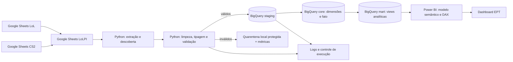

# EPT Analytics Pipeline | Google Sheets → Python → BigQuery → Power BI

> **Projeto guiado, end-to-end, para portfólio de Engenharia e Análise de Dados.** Status: especificação inicial; implementação pendente. O inventário inicial está documentado; o contrato e as regras pendentes devem ser validados antes de executar as consultas ilustrativas.

## Sumário

1. [Visão geral](#1-visão-geral)
2. [Arquitetura e organização](#2-arquitetura-e-organização)
3. [Pré-requisitos](#3-pré-requisitos)
4. [Fluxo de dados](#4-fluxo-de-dados)
5. [Requisitos do projeto](#5-requisitos-do-projeto)
6. [Qualidade, custos e segurança](#6-qualidade-custos-e-segurança)
7. [Entregáveis e definição de pronto](#7-entregáveis-e-definição-de-pronto)
8. [Referências e premissas](#8-referências-e-premissas)

## 1. Visão geral

### Contexto do negócio

O projeto analisa o **ranking EPT de esports nas modalidades League of Legends (LoL) e Counter-Strike 2 (CS2)**: equipes, partidas, campeonatos, pontuação por tier e penalidade de inatividade.

**Base de contexto:** [Análise técnica das planilhas EPT](Analise_Planilhas_EPT_para_README.md), com leitura registrada em **07/11/2026**. Contagens e fórmulas abaixo são observações dessa leitura, sujeitas a mudanças nas fontes; não representam nova inspeção das planilhas. Os exemplos usam um contrato normalizado proposto, ainda a implementar.

- [EPT LoL — 29.12.26 (fonte A)](https://docs.google.com/spreadsheets/d/1kMau11VHrNjGijHWZ1ii0c_U2zcuCTUE_T04MReKjJE/edit?usp=sharing)
- [EPT CS2 (fonte B)](https://docs.google.com/spreadsheets/d/1ivLs5NDUxHZNU8cK8RRSIzfWVoGPKd2R6B9eah2elx8/edit?usp=sharing)

| Fonte | Abas | Papel |
|---|---|---|
| LoL | `PONTUAÇÃO LoL`, `PARTIDAS LOL`, `CAMPEONATOS` | Pontuação por equipe/evento, partidas e campeonatos |
| CS2 | `PONTUAÇÃO CS2`, `PARTIDAS CS2`, `CAMPEONATOS` | Pontuação por equipe/evento, mapas/partidas e cadastro a validar |
| Ambas | `PONTUAÇÃO TIER` | Dois blocos independentes: regras por partida e por colocação final |
| LoL / CS2 | `EPT LoL` / `EPT CS2` e `SITE ABA RANKING` | Saídas derivadas para reconciliação; não carregar como fatos adicionais |

Na leitura registrada, LoL tinha 224 linhas de pontuação (incluindo placeholder), 529 linhas de partidas com conteúdo e 34 campeonatos. CS2 tinha 199 linhas de pontuação após o cabeçalho, 185 nomes preenchidos e 184 únicos, 34 linhas de partidas com conteúdo e 22 campeonatos. Esses volumes são referência inicial, não limites fixos de extração.

### Objetivo técnico

Implementar uma ingestão reproduzível via **Google Sheets LoLPI**, limpar e validar registros com Python, publicar dados tratados no **BigQuery**, modelar um **esquema estrela** e consumir o Data Mart no **Power BI**. Demonstrar testes, idempotência, logs, controle de erros, versionamento e documentação.

### Perguntas de negócio

- Quais equipes lideram o EPT em cada modalidade?
- Como pontos base, eventos e penalidade compõem o ranking atual?
- Qual o desempenho por equipe, campeonato, tier e formato BO1/BO3/BO5?
- Quantos registros de jogos/mapas, vitórias e derrotas existem por período?
- Quais equipes ocupam as colocações finais dos campeonatos?
- Onde o ranking completo diverge das saídas das planilhas?

**Regras observadas, sujeitas à confirmação do responsável:**

- LoL: `SUM(D:BG) × (1 − penalidade_inatividade)` por equipe. A penalidade já é fração decimal: 0,71 representa 71%; não dividir novamente por 100.
- CS2: `SUM(D:AX)` por equipe, sem aplicar a penalidade da coluna C na fórmula observada. Não igualar automaticamente à regra de LoL.
- As somas incluem todos os campos numéricos do intervalo, inclusive campos sem prefixo `PTS`. Confirmar sua semântica antes de reinterpretar contribuições.
- Pontos por partida dependem de tier, formato e resultado A/B. Pontos negativos de derrota são válidos. Validar entradas para impedir os fallbacks das fórmulas atuais para resultado/formato inesperado.
- Ranking atual é uma medida por equipe/modalidade, não aditiva no tempo. Sua evolução depende de snapshots efetivamente armazenados; não há histórico de posições comprovado.
- Granularidade mapa/jogo/série de CS2 e desempate do ranking permanecem pendentes. Contagem de registros não equivale a contagem de séries.

| Tier | BO1 vitória / derrota | BO3 vitória / derrota | BO5 vitória / derrota |
|---|---:|---:|---:|
| S | +10 / -10 | +15 / -15 | +20 / -20 |
| A | +8 / -8 | +12 / -12 | +15 / -15 |
| B | +6 / -6 | +9 / -9 | +12 / -12 |
| C | +4 / -4 | +6 / -6 | +8 / -8 |
| D | 0 / 0 | 0 / 0 | 0 / 0 |

| Tier | 1º | 2º | 3º | 4º | 5º | 6º | 7º | 8º |
|---|---:|---:|---:|---:|---:|---:|---:|---:|
| S | 100 | 75 | 60 | 50 | 40 | 30 | 20 | 10 |
| A | 75 | 50 | 40 | 35 | 30 | 25 | 15 | 10 |
| B | 50 | 35 | 30 | 25 | 20 | 15 | 10 | 5 |
| C | 25 | 20 | 15 | 10 | 8 | 6 | 4 | 2 |

Não há regra observada de colocação final para tier D; não presumir zero. As regras coincidem nas duas fontes na leitura registrada; preservar modalidade e versão/data de referência até confirmar se são compartilhadas.

### Habilidades trabalhadas

Python, Pandas, Google Sheets LoLPI, autenticação por Service Account, contratos de dados, validação, SQL analítico, BigQuery, `MERGE`, modelagem dimensional, DAX (`SUM`, `DIVIDE`, `CALCULATE`, `DISTINCTCOUNT`), Power Query, visualização, Git e pytest. A transformação principal será em Python/BigQuery; o Power Query servirá para inspeção e ajustes leves de apresentação, sem duplicar regras de negócio.

## 2. Arquitetura e organização

### Estrutura proposta

```text
retail-analytics-pipeline/
├── README.md
├── requirements.txt
├── .env.example
├── .gitignore
├── config/
│   ├── sources.example.yaml      # IDs, abas e mapeamentos, após descoberta
│   └── data_contract.md          # esquema validado, granularidade e regras
├── scripts/
│   ├── discover.py               # enumeração de abas e cabeçalhos
│   ├── extract.py                # Google Sheets LoLPI
│   ├── transform.py              # limpeza e tipagem
│   ├── validate.py               # verificações e quarentena
│   ├── load.py                   # carga no BigQuery
│   └── pipeline.py               # orquestração local
├── queries/
│   ├── 01_datasets.sql
│   ├── 02_staging.sql
│   ├── 03_dimensions.sql
│   ├── 04_fact.sql
│   ├── 05_marts.sql
│   └── 06_quality_checks.sql
├── tests/
│   ├── test_transform.py
│   ├── test_validate.py
│   └── test_idempotency.py
├── data/
│   └── rejected/.gitkeep        # não publicar dados pessoais
├── logs/.gitkeep
├── pbix/
│   ├── ept_analytics.pbix     # produzido no Power BI Desktop
│   └── dax_measures.md
└── docs/
    ├── data_dictionary.md
    ├── architecture.md
    ├── dashboard_screenshots/
    └── decisions.md
```

### Camadas de dados

| Camada | Local | Responsabilidade |
|---|---|---|
| Fonte | Google Sheets | Dados operacionais; nunca editar via pipeline |
| Extração | Python local | Ler via API, preservar referência de aba/linha |
| Preparação | Python local | Normalização, tipos, regras, rejeitados |
| Staging | BigQuery `ept_staging` | Dados limpos com metadados de execução |
| Core | BigQuery `ept_core` | Dimensões e fato no grão documentado |
| Mart | BigQuery `ept_mart` | Visões analíticas e indicadores reutilizáveis |
| Consumo | Power BI Desktop | Modelo semântico, DAX, filtros e visuais |

**Decisão de projeto:** usar cargas completas e substituição atômica de tabelas de staging no MVP, seguida de reconstrução determinística de core/marts. Isso é mais simples e seguro para bases pequenas que um incremental prematuro. Evolução opcional: `MERGE` por chave natural estável, controle de exclusões e snapshots.

## 3. Pré-requisitos

- Python **3.11+**, Git, VS Code, Power BI Desktop (Windows), projeto GCP com faturamento/cotas verificados e BigQuery API habilitada.
- Google Sheets LoLPI habilitada no mesmo projeto (ou projeto autorizado), Service Account com acesso **Leitor** às duas planilhas, e permissões mínimas no BigQuery para criar jobs e gravar nos datasets previstos.
- Uma identidade para Python (Service Account) e uma identidade de usuário/organizacional para o conector BigQuery no Power BI; permissões de consulta no Data Mart.
- Confirmar região do BigQuery (ex.: `southamerica-east1`), custos de armazenamento/consultas e eventuais restrições do sandbox gratuito. **Não presumir que cargas e DML funcionam sem billing**.

### `requirements.txt`

```txt
pandas>=2.2,<3
numpy>=1.26,<3
gspread>=6,<7
google-auth>=2,<3
google-cloud-bigquery>=3,<4
google-cloud-bigquery-storage>=2,<3
pyarrow>=17,<24
python-dotenv>=1,<2
PyYAML>=6,<7
pytest>=8,<10
```

> Faixas são sugestões de compatibilidade, não versões congeladas. Após instalar e validar, gerar um arquivo de lock para reprodutibilidade. `google-cloud-bigquery-storage` é opcional para leitura acelerada, mas está incluído no ambiente didático.

### Inicialização

```powershell
python -m venv .venv
.\.venv\Scripts\Activate.ps1
python -m pip install -r requirements.txt
Copy-Item .env.example .env
```

`.env.example` (sem segredos):

```dotenv
GCP_PROJECT_ID=seu-projeto
BQ_LOCATION=southamerica-east1
GOOGLE_APPLICATION_CREDENTIALS=C:/caminho/privado/service-account.json
SHEET_A_ID=1kMau11VHrNjGijHWZ1ii0c_U2zcuCTUE_T04MReKjJE
SHEET_B_ID=1ivLs5NDUxHZNU8cK8RRSIzfWVoGPKd2R6B9eah2elx8
```

**Autenticação:** em desenvolvimento local, preferir Application Default Credentials (`gcloud auth application-default login`) quando permitido; se usar JSON de Service Account, guardá-lo **fora do repositório**. Compartilhar cada planilha com o `client_email` da Service Account: ela é uma identidade distinta da conta pessoal que criou a planilha. Nunca commitar `.env`, chaves, dumps com dados pessoais ou dados identificáveis.

`.gitignore` mínimo:

```gitignore
.venv/
.env
*.json.key
*service-account*.json
__pycache__/
.pytest_cache/
logs/*
!logs/.gitkeep
data/rejected/*
!data/rejected/.gitkeep
```

## 4. Fluxo de dados



## 5. Requisitos do projeto

> **Modo Trybe:** desenvolver cada requisito em branch própria, abrir PR, incluir evidências e somente avançar após os critérios de aceite. Os exemplos são **esqueletos orientativos**, não substituem o mapeamento do esquema real. Para executar SQL, substituir `SEU_PROJETO` pelo ID do projeto e adaptar nomes de campos documentados.

### Requisito 1 — Preparar repositório e ambiente

**Objetivo:** instalar dependências, configurar credenciais e verificar acesso às APIs.

**Detalhamento e orientação:** criar a estrutura, `.env.example`, `.gitignore`, ambiente virtual e projeto GCP. Configurar papéis mínimos: `roles/bigquery.jobUser` no projeto de execução e `roles/bigquery.dataEditor` apenas nos datasets de escrita; `roles/bigquery.dataViewer` para consumo. Habilitar APIs e compartilhar as duas planilhas com a Service Account.

**Exemplo:**

```python
from dotenv import load_dotenv
from google.cloud import bigquery
import os

load_dotenv()
client = bigquery.Client(project=os.environ['GCP_PROJECT_ID'])
print('Projeto autenticado:', client.project)
```

**O que será testado:** ambiente sobe sem chave no Git; autenticação funciona; acesso de leitura ao Sheets e criação de job no BigQuery são confirmados separadamente.

### Requisito 2 — Descobrir as planilhas e fechar o contrato de dados

**Objetivo:** identificar **quais abas e colunas existem de fato**, qual a granularidade e como as duas fontes se relacionam.

**Detalhamento e orientação:** partir do inventário EPT e revalidar abas, intervalos úteis, cabeçalhos, tipos e fórmulas pela API. Registrar em `docs/data_dictionary.md`: planilha, modalidade, aba, posição da coluna, nome original, nome canônico, tipo, obrigatoriedade, regra e exemplo. Mapear os dois blocos de regras separadamente. Preservar posições dos cabeçalhos duplicados `FEMEE EPT S1` (T/U em LoL; Q/R em CS2) até confirmar a semântica. Definir granularidade de partidas/mapas/séries, aliases e significado de cada coluna de evento. Registrar decisões e pendências da seção 8 no contrato.

**Exemplo:**

```python
import os
import gspread
from dotenv import load_dotenv

load_dotenv()
gc = gspread.service_account() if not os.getenv('GOOGLE_APPLICATION_CREDENTIALS') else gspread.authorize(
    __import__('google.auth', fromlist=['default']).default(
        scopes=['https://www.googleapis.com/auth/spreadsheets.readonly']
    )[0]
)
for key in ('SHEET_A_ID', 'SHEET_B_ID'):
    book = gc.open_by_key(os.environ[key])
    for tab in book.worksheets():
        print(key, tab.title, tab.row_count, tab.col_count)
        print('Primeiras linhas:', tab.get('A1:K5'))
```

**O que será testado:** inventário completo das duas planilhas; contrato aprovado; nenhum cabeçalho ou relacionamento presumido; ausência de abas esperadas documentada como impedimento/ajuste de escopo.

### Requisito 3 — Extrair via API, sem download manual

**Objetivo:** ler as fontes com Python e manter rastreabilidade.

**Detalhamento e orientação:** usar `gspread`, leitura por aba, respeitar cotas, preservar `source_spreadsheet_id`, `source_tab`, `source_row` e `extracted_at`. Não usar exportação manual CSV/Excel. Configurar intervalos e cabeçalhos por bloco; a coluna A de partidas é vazia. Capturar valores não formatados para cálculos e fórmulas separadamente para auditoria. Datas podem vir como seriais do Sheets. O exemplo abaixo usa valores exibidos e deve ser adaptado aos blocos e cabeçalhos repetidos, preservando posições sem perda de colunas.

**Exemplo:**

```python
from datetime import datetime, timezone
import pandas as pd

def extract_tab(book, tab_name, header_row=1):
    rows = book.worksheet(tab_name).get_all_values()
    headers = rows[header_row - 1]
    records = rows[header_row:]
    df = pd.DataFrame(records, columns=headers)
    df['source_row'] = range(header_row + 1, header_row + 1 + len(df))
    df['source_tab'] = tab_name
    df['source_spreadsheet_id'] = book.id
    df['extracted_at'] = datetime.now(timezone.utc)
    return df
```

**O que será testado:** total de linhas lidas por aba; execução repetível; erro claro para aba inexistente; nenhuma alteração na fonte.

### Requisito 4 — Normalizar campos e corrigir tipos

**Objetivo:** transformar dados heterogêneos em registros consistentes.

**Detalhamento e orientação:** normalizar espaços, datas e números conforme representação da API. Valores exibidos usam cultura pt-BR; datas seriais exigem conversão explícita e política de fuso. Preservar penalidades fracionárias e pontos negativos. Definir o significado de hífen, N/A, vazio e zero por campo antes de converter para nulo.

Criar IDs e aliases por modalidade. Despivotar colunas de eventos mantendo posição e tipo de campo (resultado/colocação/pontos); preservar pontos base separadamente, sem repeti-los por evento. Despivotar posições 1º–8º dos campeonatos. Separar os dois blocos de regras. Em LoL, confirmar unidade/formato de `GAME TIME`; em CS2, separar mapa e placar. Excluir embeds HTML do modelo e validar URLs necessárias.

**Exemplo:**

```python
import pandas as pd

def clean_text(value):
    if pd.isna(value):
        return None
    return ' '.join(str(value).strip().split()) or None

# Preservar placeholders até definir sua semântica por campo.
assert clean_text('  GHOST   GAMING ') == 'GHOST GAMING'
assert clean_text('-') == '-'
```

**O que será testado:** percentuais sem conversão dupla; datas seriais/exibidas; preservação de zero e pontos negativos; cabeçalhos repetidos sem perda; aliases por modalidade; unpivot sem repetir pontos base; idempotência.

### Requisito 5 — Validar dados e produzir quarentena

**Objetivo:** impedir que registros inválidos contaminem os indicadores.

**Detalhamento e orientação:** verificar IDs, equipes identificáveis, modalidade, datas, tier, formato, resultado e integridade com campeonatos. Pontos negativos de derrota são válidos. Distinguir incompletos, não aplicáveis e jogos não disputados conforme contrato. Investigar as duas ocorrências de GHOST GAMING no CS2 antes de deduplicar ou somar. Linhas sem equipe, placeholders e fórmulas sem chave não entram no ranking válido; contabilizar linhas vazias separadamente. Rejeitados preservam fonte, linha e motivo, sem dados pessoais desnecessários em logs.

**Exemplo (subconjunto de regras para registros concluídos):**

```python
def validate_matches(df):
    required = ['game_id', 'team_a_id', 'team_b_id', 'match_date',
                'tier', 'format', 'result']
    missing = [c for c in required if c not in df.columns]
    if missing:
        raise ValueError(f'Colunas obrigatórias ausentes: {missing}')
    mask = (
        df[required].notna().all(axis=1)
        & df['game_id'].isin(['LoL', 'CS2'])
        & df['tier'].isin(['S', 'A', 'B', 'C', 'D'])
        & df['format'].isin(['BO1', 'BO3', 'BO5'])
        & df['result'].isin(['A', 'B'])
        & df['team_a_id'].ne(df['team_b_id'])
    )
    return df.loc[mask].copy(), df.loc[~mask].copy()
```

**O que será testado:** candidatos = válidos + rejeitados; vazios/separadores contabilizados à parte; esquema incompatível interrompe pipeline. A validação completa também verifica IDs canônicos, placeholders, referências e pontos conforme regras por modalidade/versão.

### Requisito 6 — Carregar staging no BigQuery

**Objetivo:** publicar dados limpos com esquema explícito.

**Detalhamento e orientação:** criar `ept_staging`, `ept_core` e `ept_mart` na mesma localização; para MVP, carregar DataFrame em tabela temporária de execução e publicar por substituição controlada após sucesso. Evitar `WRITE_APPEND` a cada reexecução, que duplicaria linhas. Definir tipos de schema explicitamente; pontos e penalidades devem ser `NUMERIC`, datas `DATE` e metadados UTC `TIMESTAMP`. Definir data/hora de partidas conforme contrato.

**Exemplo (tabela de execução, antes da promoção):**

```python
from google.cloud import bigquery

client = bigquery.Client()
# run_id deve ser um identificador seguro gerado pelo pipeline.
table_id = f'{client.project}.ept_staging.matches_run_{run_id}'
config = bigquery.LoadJobConfig(
    write_disposition=bigquery.WriteDisposition.WRITE_TRUNCATE,
    schema=[
        bigquery.SchemaField('source_record_key', 'STRING'),
        bigquery.SchemaField('game_id', 'STRING'),
        bigquery.SchemaField('team_a_id', 'STRING'),
        bigquery.SchemaField('team_b_id', 'STRING'),
        bigquery.SchemaField('match_date', 'DATE'),
        bigquery.SchemaField('points_a', 'NUMERIC'),
        bigquery.SchemaField('points_b', 'NUMERIC'),
    ],
)
# matches_df deve conter exatamente os campos/tipos deste exemplo reduzido.
job = client.load_table_from_dataframe(matches_df, table_id, job_config=config)
job.result()
print('Linhas carregadas:', client.get_table(table_id).num_rows)
# Validar e promover para matches_clean antes de reconstruir core/marts.
```

**O que será testado:** contagens entre DataFrame e staging; nenhuma duplicação após duas execuções; falhas não deixam tabela publicada parcialmente atualizada. Promover tabelas de execução somente após validação.

### Requisito 7 — Construir dimensões no BigQuery

**Objetivo:** preparar entidades descritivas para o modelo estrela.

**Detalhamento e orientação:** criar `dim_game`, `dim_team`, `dim_championship` e `dim_date`. IDs de equipe/campeonato incorporam modalidade e aliases confirmados; nomes homônimos entre modalidades não implicam mesma entidade. Usar dimensões tipo 1 no MVP. Validar cobertura e modalidade do cadastro de campeonatos CS2.

**Exemplo SQL (cadastro canônico previamente validado):**

```sql
CREATE OR REPLACE TABLE `SEU_PROJETO.ept_core.dim_team` AS
SELECT team_id, game_id, canonical_name
FROM `SEU_PROJETO.ept_staging.teams_clean`;
```

**O que será testado:** IDs únicos e não nulos; aliases sem ambiguidade; atributos conflitantes interrompem publicação; nenhuma escolha arbitrária de atributos.

### Requisito 8 — Construir fatos EPT e calendário

**Objetivo:** estabelecer granularidade analítica consistente.

**Detalhamento e orientação:** criar `fact_match` no grão confirmado de registro de jogo/mapa, com modalidade, campeonato, data/hora, fase, tier, formato, equipes A/B, resultado e pontos. Um `match_record_id` identifica esse registro; só criar ID de série após confirmar identidade e agrupamento. As fontes não têm IDs estáveis: manter mapeamento persistente; fonte/linha é referência técnica que muda com reordenação.

Criar `fact_match_participation` com duas linhas por registro concluído (uma por equipe), evitando relacionamentos A/B ambíguos. Criar `fact_team_event_score` no grão modalidade/equipe/evento/campo de origem, distinguindo resultado/colocação de pontos; colocações finais ficam em tabela campeonato/posição/equipe. Não somar pontos de partidas ao histórico de eventos sem comprovar linhagem: podem ser contribuições já acumuladas.

Normalizar `scoring_rule_match` e `scoring_rule_placement` separadamente, com modalidade e versão. Criar calendário sem lacunas. Particionar fatos datados por data; não inventar datas de eventos.

**Exemplo SQL (participação de registros concluídos e validados):**

```sql
CREATE OR REPLACE TABLE `SEU_PROJETO.ept_core.fact_match_participation`
PARTITION BY match_date
CLUSTER BY game_id, team_id AS
SELECT match_record_id, game_id, championship_id, match_date,
       team_a_id AS team_id, 'A' AS side,
       result = 'A' AS is_win, points_a AS points
FROM `SEU_PROJETO.ept_staging.matches_clean`
UNION ALL
SELECT match_record_id, game_id, championship_id, match_date,
       team_b_id AS team_id, 'B' AS side,
       result = 'B' AS is_win, points_b AS points
FROM `SEU_PROJETO.ept_staging.matches_clean`;
```

**O que será testado:** unicidade registro/lado; duas participações por registro concluído; pontos A/B reconciliados; grão mapa/série documentado; contribuições e pontos base sem duplicação.

### Requisito 9 — Criar Data Mart e indicadores SQL

**Objetivo:** disponibilizar uma camada estável e de fácil consumo pelo Power BI.

**Detalhamento e orientação:** publicar views de participação, eventos, colocações e ranking atual. Calcular ranking sobre toda a população válida, preservando pontos antes da penalidade, penalidade informada, regra aplicada e EPT final. Reproduzir fórmulas observadas para auditoria; mudanças de negócio exigem decisão registrada. Comparar saídas truncadas sem tratá-las como ranking completo correto.

A tabela `ranking_current` terá uma linha por modalidade/equipe e data de referência da carga. Snapshots históricos são opcionais e só existem após armazenamento. Filtros de partidas por período não representam recálculo histórico do EPT.

**Exemplo:**

```sql
CREATE OR REPLACE VIEW `SEU_PROJETO.ept_mart.vw_match_participation` AS
SELECT f.*, t.canonical_name AS team_name
FROM `SEU_PROJETO.ept_core.fact_match_participation` AS f
LEFT JOIN `SEU_PROJETO.ept_core.dim_team` AS t USING (team_id, game_id);
```

```sql
SELECT game_id, team_id,
       DATE_TRUNC(match_date, MONTH) AS month,
       COUNT(*) AS records_played,
       COUNTIF(is_win) AS wins,
       SAFE_DIVIDE(COUNTIF(is_win), COUNT(*)) AS win_rate,
       SUM(points) AS match_points
FROM `SEU_PROJETO.ept_mart.vw_match_participation`
GROUP BY 1, 2, 3;
```

**O que será testado:** totais reconciliados; joins sem multiplicação; duas participações não contam como dois jogos globais; denominador zero protegido; ranking completo; empates sinalizados até confirmar desempate; regra de penalidade por modalidade respeitada.

### Requisito 10 — Conectar Power BI ao BigQuery

**Objetivo:** carregar dados analíticos sem exportações manuais.

**Detalhamento e orientação:** no Power BI Desktop, **Obter dados → Google BigQuery**, autenticar com identidade autorizada, escolher projeto/dataset e carregar as views/tabelas selecionadas. Para o MVP, usar **Import** (mais simples para aprender DAX e relacionamentos); avaliar DirectQuery apenas como evolução, considerando custos, latência e limitações. Conferir tipos no Power Query; não repetir limpeza já feita em Python. Se usar a fato e as dimensões, criar relacionamentos 1:* com direção de filtro única; se usar apenas view achatada, não duplicar dimensões desnecessariamente.

**Exemplo de modelo:**

```text
dim_date[date]                    (1) ─── (*) fact_match_participation[match_date]
dim_game[game_id]                 (1) ─── (*) fact_match_participation[game_id]
dim_team[team_id]                 (1) ─── (*) fact_match_participation[team_id]
dim_championship[championship_id] (1) ─── (*) fact_match_participation[championship_id]
```

Usar IDs globalmente únicos incorporando modalidade. Conectar dimensões diretamente aos demais fatos compatíveis, evitando caminhos duplicados entre dimensões. Ranking atual recebe filtros de equipe/modalidade sem relacionamento temporal que simule histórico inexistente.

**O que será testado:** conexão autenticada; atualização sem erros; tipos corretos; filtros alteram métricas sem ambiguidades.

### Requisito 11 — Criar medidas DAX e validar semântica

**Objetivo:** construir KPIs que respondem ao contexto dos filtros.

**Detalhamento e orientação:** criar tabela de medidas e conferir nomes reais. Os exemplos pressupõem participação por equipe em registros concluídos e ranking atual com uma linha por modalidade/equipe.

**Exemplo DAX:**

```dax
Registros de Jogo = DISTINCTCOUNT(fact_match_participation[match_record_id])

Participações = COUNTROWS(fact_match_participation)

Vitórias =
    CALCULATE([Participações], fact_match_participation[is_win] = TRUE())

Derrotas =
    CALCULATE([Participações], fact_match_participation[is_win] = FALSE())

Taxa de Vitória = DIVIDE([Vitórias], [Participações])

Pontos de Partidas = SUM(fact_match_participation[points])

Equipes Participantes = DISTINCTCOUNT(fact_match_participation[team_id])

EPT Atual da Equipe =
    IF(
        HASONEVALUE(dim_game[game_id]) && HASONEVALUE(dim_team[team_id]),
        MAX(ranking_current[ept_points]),
        BLANK()
    )
```

**O que será testado:** SQL/DAX equivalentes sob mesmos filtros; porcentagens corretas; EPT sem soma entre modalidades/snapshots; mapas não rotulados como séries; taxa global por participação distinguida da taxa de uma equipe.

### Requisito 12 — Construir dashboard EPT

**Objetivo:** entregar relatório interativo, legível e orientado à análise competitiva.

**Detalhamento e orientação:** seguir hierarquia de leitura em Z. Página 1 — **Ranking EPT Atual**: classificação e Top 20 por modalidade, pontos base, pontuação antes/depois da regra de penalidade e data de referência; empates explícitos. Página 2 — **Partidas e Campeonatos**: registros de jogos/mapas, vitórias, derrotas, taxa de vitória, pontos e colocações, filtrados por modalidade, equipe, campeonato, tier, formato e período. Duração LoL depende de unidade validada; mapa/placar CS2 são campos próprios. Página 3 — **Qualidade e Operação**: processados, rejeitados, última carga, duplicidades, campeonatos sem correspondência e divergências de ranking, com métricas publicadas no BigQuery.

**Exemplo de configuração de visual:**

```text
Visual: gráfico de barras horizontal
Eixo: dim_team[canonical_name]
Valores: [EPT Atual da Equipe]
Filtro obrigatório: uma modalidade
Filtro do visual: Top N = 20, por [EPT Atual da Equipe]
Ordenação: EPT decrescente; sinalizar empates na fronteira do Top 20
Interações: equipe selecionada filtra detalhes e composição de pontos
```

**O que será testado:** títulos e grãos explícitos; filtros cruzados; Top 20 sobre base completa; política de empates documentada; ausência de histórico inventado; alertas para pendências; capturas em `docs/dashboard_screenshots/`.

### Requisito 13 — Automatizar execução, testes e documentação

**Objetivo:** permitir reconstruir o pipeline sem passos manuais de manipulação de dados.

**Detalhamento e orientação:** `pipeline.py` executa descoberta validada → extração → transformação → validação → carga → SQL de core/marts → checagens finais. Cada execução tem `run_id`, horário, status, contagens e duração. Separar falhas de credencial, esquema, qualidade e BigQuery. O pipeline deve interromper antes da publicação se uma validação crítica falhar. Documentar instruções de execução e limitações.

**Exemplo de teste:**

```python
import pandas as pd
from scripts.validate import validate_matches

def test_rejects_unexpected_result():
    df = pd.DataFrame([{
        'game_id': 'CS2', 'team_a_id': 'CS2:A', 'team_b_id': 'CS2:B',
        'match_date': pd.Timestamp('2025-09-12'),
        'tier': 'A', 'format': 'BO3', 'result': 'EMPATE'
    }])
    valid, rejected = validate_matches(df)
    assert len(valid) == 0
    assert len(rejected) == 1
```

Incluir testes para pontos negativos válidos, penalidade fracionária LoL, fórmula observada CS2 sem penalidade, aliases, cabeçalhos repetidos e ranking completo versus faixas truncadas.

**Comandos:**

```powershell
python -m pytest -q
python -m scripts.discover
python -m scripts.pipeline
```

**O que será testado:** testes unitários passam; execução repetida mantém totais; logs sem PII; falha em etapa intermediária não publica mart inconsistente; instruções permitem reproduzir em outra máquina.

### Requisito 14 — Entrega, revisão e portfólio

**Objetivo:** publicar código, documentação e evidências de forma profissional.

**Detalhamento e orientação:** criar branch `feat/requisito-XX`, commitar pequenas mudanças e abrir PR com objetivo, decisões, testes e prints. Não versionar dados pessoais, credenciais ou arquivos de configuração sensíveis. Incluir no README final screenshots, arquitetura, exemplos de queries e limitações. O `.pbix` pode ser versionado se tamanho/licença e privacidade permitirem; caso contrário, documentar reprodução e disponibilizar apenas imagens sem dados sensíveis.

**Exemplo de Git:**

```bash
git checkout -b feat/requisito-02-discovery
git add scripts/discover.py docs/data_dictionary.md
git commit -m "feat: discover Google Sheets schemas"
git push -u origin feat/requisito-02-discovery
```

**O que será testado:** README reproduzível; PRs documentados; nenhum segredo ou dado pessoal exposto; dashboard e SQL reconciliados; projeto compreensível por recrutador técnico.

## 6. Qualidade, custos e segurança

### Checks mínimos de dados

| Check | Regra de aceite |
|---|---|
| Contagem | Extraídos = válidos + rejeitados |
| Unicidade de dimensão | Nenhuma chave natural duplicada |
| Integridade referencial | Chaves ausentes identificadas e tratadas por política explícita |
| Fato | Sem duplicatas de chave de linha estável |
| Valores | Pontos negativos conforme regra; penalidade entre 0 e 1; datas e domínios válidos |
| Reconciliação | Pontos consistentes entre staging/core/mart; ranking completo comparado às saídas derivadas |
| Reexecução | Segunda carga idêntica não altera contagens/totais |
| Observabilidade | `run_id`, status, duração, volume e rejeições registrados |

### Custos

BigQuery pode cobrar por armazenamento, consultas, jobs e transferência conforme configuração. Definir orçamento e alertas no GCP; usar datasets de desenvolvimento, selecionar apenas colunas necessárias, limitar scans com partições, inspecionar bytes estimados e evitar refresh frequente durante testes. O histórico de erro `DML queries are not allowed in the free tier` é um lembrete para **validar billing antes de depender de `DELETE` ou `MERGE`**. Se não houver faturamento habilitado, ajustar estratégia e escopo às operações efetivamente permitidas, sem prometer funcionamento irrestrito no sandbox.

### Privacidade e segurança

- Aplicar menor privilégio às identidades; nunca publicar chaves JSON.
- Verificar se as planilhas contêm dados pessoais reais; mascarar amostras e screenshots.
- Evitar nomes/e-mails de pessoas em logs e mart público.
- Documentar retenção de rejeitados e acesso aos datasets.
- Tratar `data/rejected` como local protegido e ignorado pelo Git.

## 7. Entregáveis e definição de pronto

### Checklist evolutivo

- [ ] R1 — Ambiente e credenciais
- [ ] R2 — Inventário das duas planilhas e contrato real de dados
- [ ] R3 — Extração via Google Sheets LoLPI
- [ ] R4 — Normalização e tipagem
- [ ] R5 — Validação e quarentena
- [ ] R6 — Staging BigQuery
- [ ] R7 — Dimensões
- [ ] R8 — Fatos EPT e calendário
- [ ] R9 — Data Mart e reconciliação SQL
- [ ] R10 — Conexão Power BI
- [ ] R11 — Medidas DAX
- [ ] R12 — Dashboard final
- [ ] R13 — Automação e testes
- [ ] R14 — Documentação e portfólio

### Critérios finais de aceite

1. A ingestão parte exclusivamente da API do Sheets, sem CSV baixado manualmente.
2. O contrato de dados corresponde às abas e colunas **efetivamente inspecionadas**.
3. O pipeline é reexecutável, registra falhas e não duplica fatos.
4. O BigQuery disponibiliza fatos/dimensões ou um mart equivalente coerente com a granularidade real.
5. O Power BI consulta o BigQuery e apresenta indicadores validados com SQL.
6. Testes unitários e de reconciliação são executáveis.
7. Repositório contém documentação, evidências e nenhum segredo ou dado sensível.

### Evoluções opcionais (não bloquear MVP)

- Carga incremental com `MERGE` e estratégia de exclusões.
- GitHub Actions com autenticação por Workload Identity Federation, sem chaves persistentes.
- dbt/Dataform para testes e transformação SQL.
- Tabelas de auditoria e alertas automáticos.
- Power BI Service com agendamento de atualização, sujeito a licença, credenciais e políticas da organização.
- Snapshots de ranking para comparação temporal a partir da implantação, com regras versionadas.

## 8. Referências e premissas

**Materiais fornecidos:**

- [Análise técnica das planilhas EPT](Analise_Planilhas_EPT_para_README.md): fonte do contexto, inventário, fórmulas e alertas; leitura registrada em 07/11/2026.
- *Memória de contexto técnica — Curso Básico de Power BI 2026* (material anteriormente fornecido): referência didática de modelagem estrela, DAX, leitura em Z e Top N. O domínio deste projeto é EPT.
- *API de Receitas* (README de referência anteriormente fornecido): inspira a estrutura por requisitos, instruções, testes, Git/PR e critérios de aceite.
- [Curso Básico de Power BI 2026 — Hashtag Treinamentos](https://www.youtube.com/watch?v=7cUrsltJbEI).
- [Google Sheets API](https://developers.google.com/workspace/sheets/api/guides/concepts).
- [BigQuery — documentação oficial](https://cloud.google.com/bigquery/docs).
- [Power BI — conector Google BigQuery](https://learn.microsoft.com/power-query/connectors/google-bigquery).

### Limitações observadas e decisões pendentes

| Achado na análise de 07/11/2026 | Tratamento no projeto |
|---|---|
| EPT CS2 consulta apenas A2:B100 (99 registros, 98 nomes únicos) | Recalcular sobre toda a população válida; saída atual não comprova ranking completo |
| Site LoL consulta até linha 199, omitindo 26 candidatos; site CS2 lê A2:B20 (19 candidatos) | Validar Top 20 contra base completa; alteração das fórmulas de origem cabe ao responsável |
| LoL aplica penalidade; CS2 não aplica | Preservar cálculo observado por modalidade e confirmar política |
| GHOST GAMING duplicada no CS2; 14 linhas sem equipe; placeholder em LoL | Investigar identidade, registrar exclusões e não somar/deduplicar arbitrariamente |
| FEMEE EPT S1 repetido em ambas as bases | Preservar posições e confirmar significado antes de renomear |
| EPT soma campos numéricos sem prefixo PTS | Mapear contribuições; não confundir resultado, colocação e pontos |
| Eventos com nomes LoL no CS2; campeonatos CS2 até 2024 versus partidas em 2025 | Confirmar modalidade e cadastro; tratar referências sem correspondência |
| GAME TIME distinto por modalidade; granularidade CS2 incerta | Separar duração/mapa/placar e confirmar jogo/mapa/série |
| Datas/equipes ausentes; hífen, N/A, vazio e zero | Definir ausência, bye, não participação, não aplicável e zero por campo |
| Campeonato Mineiro LoL 2026 consta EM ANDAMENTO com término em julho de 2026 | Sinalizar inconsistência e confirmar atualização do status |
| Origem de PONTOS BASE nas saídas não esclarecida; título LoL contém 29.12.26 | Confirmar linhagem e significado da data no título |
| Desempate e histórico de posições não demonstrados | Expor empates e ranking atual; evolução somente com snapshots armazenados |

O requisito 2 é a etapa obrigatória para validar o contrato e registrar decisões em `docs/decisions.md`. Permanecem pendentes permissões efetivas da identidade de execução, frequência de atualização e política de dados pessoais. Pendências críticas impedem a publicação dos indicadores afetados como definitivos. O pipeline mantém as planilhas em modo somente leitura.

---

**Resultado esperado:** um projeto demonstrável de Engenharia de Dados e Business Intelligence, com coleta automatizada, qualidade, Data Warehouse, modelagem analítica, métricas verificáveis e dashboard profissional — desenvolvido em etapas, com autonomia e evidências técnicas.
